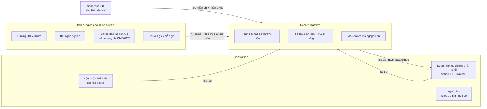

# 01. Phân tích Doccen.vn

> Nguồn: nội dung công khai đã được index (xem mục *Nguồn* cuối trang). Chưa truy cập trực tiếp được do network policy, xem README.

## 1. Doccen là gì

| Hạng mục | Thông tin |
|---|---|
| Pháp nhân | Công ty Cổ phần Công nghệ Doccen (Doccen Tech., JSC). MST 0316785682, đăng ký 2021. Trụ sở TP.HCM, có văn phòng Hà Nội |
| Định vị | "Nền tảng học trực tuyến dành riêng cho cộng đồng nhân viên y tế Việt Nam": bác sĩ, dược sĩ, điều dưỡng, sinh viên khối sức khỏe |
| Quy mô công bố | Trang chủ (thời điểm index) ghi khoảng 10.000+ người dùng và 232 chủ đề kiến thức. Thông báo Doccen Library ghi hơn 10.000 tài liệu/khóa học và hơn 80.000 lượt người học |
| Nguồn nội dung | Trường đại học y dược, hội nghề nghiệp, tổ chức, chuyên gia, doanh nghiệp dược và phân phối |
| Liên quan Buymed | Có kênh `doccen.vn/buymed`: "đào tạo chuyên môn cho dược sĩ và khách hàng thuocsi.vn". Buymed, Doccen và các hãng dược (Sanofi, Boehringer Ingelheim…) đã phối hợp tập huấn và cấp CPE cho dược sĩ (ví dụ chương trình 200 dược sĩ ở Cần Thơ, 2023) |

> **Hàm ý cho dự án:** Buymed hiện đang *thuê kênh* trên Doccen. Một LMS riêng cho phép Buymed giữ dữ liệu người học, tích hợp sâu với thuocsi.vn, và có thể **trở thành nền tảng cho chính các đối tác dược** (mô hình kênh/tenant giống Doccen).

## 2. Bản đồ tính năng (suy ra từ URL và nội dung)

| Nhóm | Tính năng | Bằng chứng (URL/pattern) |
|---|---|---|
| **Cộng đồng** | Hồ sơ cá nhân chuyên môn, kết nối đồng nghiệp | `/user/{id}` |
| | Group/kênh (công khai hoặc riêng), feed bài viết, thông báo | `/my-groups/{uuid}`, ví dụ group "Chứng chỉ đào tạo y khoa liên tục (CME‑CPE)", "[Doccen] Platform Updates" |
| | Trang thương hiệu của tổ chức (kênh đối tác) | `/buymed`, `/doccen` |
| | Bài viết, tin tức, FAQ | `/home/{uuid}` |
| **LMS** | Group có tab **Khóa học**. Khóa học gồm danh sách bài học video | Hướng dẫn "tham gia khóa học trên Doccen.vn phiên bản 3.0" |
| | Danh mục khóa học theo client/academy | `/clients/courses/{id}` (Doccen Academy) |
| | **Hỏi đáp trực tiếp với diễn giả trên từng bài học** | Bài PR Buymed, Sanofi |
| | Bài kiểm tra, nền tảng thi cho học viên | "Học viên làm bài kiểm tra trên doccen.vn…" |
| **CME/CPE** | Phân phối khóa học và webinar có cấp CME/CPE, **do tổ chức/hội nghề nghiệp bảo trợ**. Học đủ và đạt bài kiểm tra theo yêu cầu của cơ sở đào tạo thì được cấp chứng chỉ | Bài "Online webinar…", FAQ CME 2025 |
| **Webinar** | Hội thảo trực tuyến, sau đó chuyển thành khóa học xem lại | PR Buymed, LinkedIn |
| **Xác thực HCP** | Khuyến nghị xác thực tài khoản bằng **chứng chỉ hành nghề hoặc bằng tốt nghiệp** | Hướng dẫn đăng ký |
| **Library** | Tìm kiếm all-in-one: khóa học, eBook, slides, quiz bank, guideline, webinar, CME | Bài ra mắt Doccen Library |
| **AI** | DoccenAI: hỏi đáp trên tài liệu PDF/Word, tra cứu guideline, luyện tập kiểu hỏi đáp và trắc nghiệm | `/ai` |
| **Dịch vụ B2B** | Gói tổ chức sự kiện đào tạo, truyền thông và nền tảng thi cho đối tác | Bài Doccen, BuyMed, Sanofi tại Cần Thơ |

## 3. Mô hình kinh doanh (suy luận)

- **Giá trị cho HCP:** học miễn phí hoặc rẻ, tích lũy giờ CME/CPE bắt buộc để gia hạn hành nghề, tài liệu tập trung.
- **Giá trị cho doanh nghiệp dược:** kênh tiếp cận HCP đã xác thực một cách hợp quy (thông tin thuốc cho người hành nghề), đo được mức độ tương tác.
- **Moat:** tệp người dùng HCP đã xác thực, quan hệ với hội và trường, và quy trình vận hành cấp CME.

## 4. Bài học rút ra cho dự án

1. **CME/CPE là lý do lớn nhất để HCP quay lại.** Phải thiết kế sẵn **sổ tích lũy CME** (credit ledger), luật hoàn thành nghiêm ngặt (xem đủ, chống tua, quiz đạt) và đối soát với cơ sở đào tạo. Nền tảng **thường không tự cấp CME**; chứng chỉ do cơ sở đào tạo đủ điều kiện cấp, nền tảng cung cấp dữ liệu và hạ tầng.
2. **Xác thực HCP (KYC) là "cổng" pháp lý và thương mại.** Nội dung thuốc kê đơn chỉ hiển thị cho người hành nghề đã xác thực. Đây cũng là giá trị bán cho nhà tài trợ.
3. **Group/kênh là đơn vị tổ chức nội dung**, không phải "khóa học" đơn lẻ. Mỗi đối tác có không gian riêng (khóa học, webinar, bài viết, thành viên). Đây chính là mô hình **multi-tenant theo chủ sở hữu nội dung**.
4. **Webinar → khóa học xem lại** là vòng đời nội dung chuẩn. Hỏi đáp gắn từng bài học giúp giữ tương tác sau sự kiện.
5. **Library + AI** là lớp giá trị gia tăng khi đã có kho nội dung đủ lớn. Không nên làm ở MVP.
6. **Doccen tích hợp còn nông với hệ sinh thái thương mại** (theo dữ liệu công khai). Buymed có lợi thế: SSO với thuocsi.vn, cá nhân hóa đào tạo theo hành vi mua, thưởng điểm và voucher, trình dược viên giao khóa học cho nhà thuốc.

## 5. Benchmark tham khảo nên khảo sát thêm

| Nền tảng | Điểm đáng học |
|---|---|
| MIMS Education (VN) | Catalog khóa CME/CPD, cấp chứng nhận ngay khi hoàn thành |
| Docquity | Cộng đồng HCP Đông Nam Á, hợp tác hội nghề nghiệp VN để đào tạo trực tuyến |
| Medscape Education | CME accredited, phân tách rõ nội dung có tài trợ và không tài trợ |
| Coursera / Udemy | UX player, progress, review, catalog |
| Moodle / Open edX | Mô hình dữ liệu LMS chuẩn, SCORM/xAPI, gradebook (tham khảo, không nhất thiết dùng) |

## Nguồn

- [Doccen.vn trang chủ](https://www.doccen.vn/) · [/homepage](https://www.doccen.vn/homepage) · [Giới thiệu](https://www.doccen.vn/home/000b0000-ac12-0242-2601-08db7578775b)
- [Doccen Library ra mắt](https://www.doccen.vn/home/08dd1f4a-6469-09ab-0242-ac1201000000) · [Threads post](https://www.threads.com/@doccen.vn/post/DDrNgaOzk3r)
- [DoccenAI](https://www.doccen.vn/ai) · [Doccen Academy](https://doccen.vn/clients/courses/4) · [Kênh Buymed](https://www.doccen.vn/buymed)
- [Group CME-CPE](https://www.doccen.vn/my-groups/000f0000-ac13-0242-2490-08dc07870f67) · [Platform Updates](https://www.doccen.vn/my-groups/08db3bd5-fcc1-4d3f-88eb-49cc5c1b9a0c)
- [Online webinar: hình thức đào tạo cấp CME](https://www.doccen.vn/home/00110000-ac13-0242-11d7-08dc119d91b0) · [FAQ CME 2025](https://www.doccen.vn/home/08dd1fef-7f4a-7abc-0242-ac1201000000)
- [Hướng dẫn tham gia khóa học v3.0](https://doccencorp.com/2023/02/14/huong-dan-tham-gia-khoa-hoc-tren-doccen-vn-phien-ban-3-0/) · [Cách dùng DoccenAI](https://doccen.edu.vn/2024/08/28/huong-dan-dang-nhap-doccenai/)
- [Doccen, BuyMed, Sanofi tập huấn 200 dược sĩ Cần Thơ](https://doccencorp.com/2023/08/21/doccen-buymed-sanofi-trien-khai-tap-huan-kien-thuc-cho-hon-200-duoc-si-o-can-tho/) · [Sức khỏe & Đời sống](https://suckhoedoisong.vn/buymed-trien-khai-chuong-trinh-tap-huan-kien-thuc-cap-chung-chi-cpe-mien-phi-cho-200-duoc-si-can-tho-169230822103351592.htm) · [Tuổi Trẻ: Buymed và Sohaco](https://tuoitre.vn/buymed-va-sohaco-dong-hanh-voi-duoc-si-20240402153203168.htm)
- [FiinGate: thông tin doanh nghiệp](https://fiingate.vn/domestic-companies/1031181) · [Joboko](https://vn.joboko.com/cong-ty-co-phan-cong-nghe-doccen-xci774853)
- [MIMS Education VN](https://education.mims.com/vn/courses) · [Docquity và VAPM](https://www.biospectrumasia.com/news/94/24749/docquity-and-vietnam-association-of-preventive-medicine-partner-to-advance-medical-training.html)
