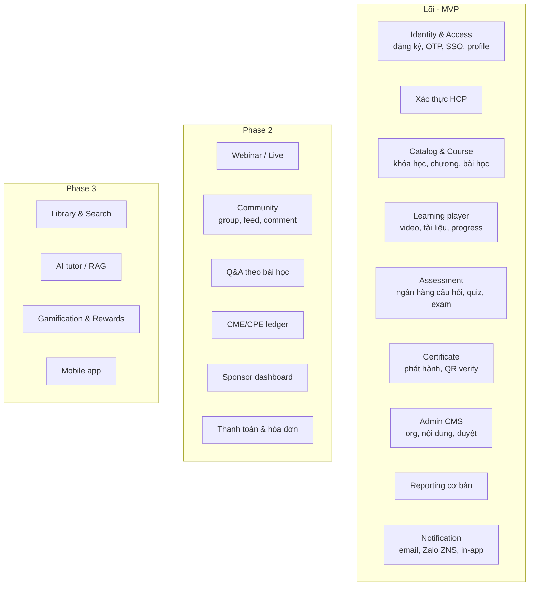
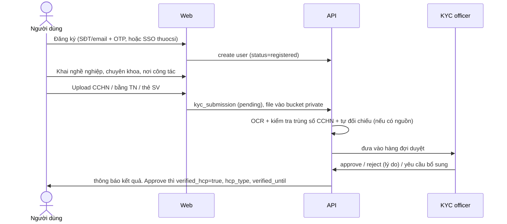
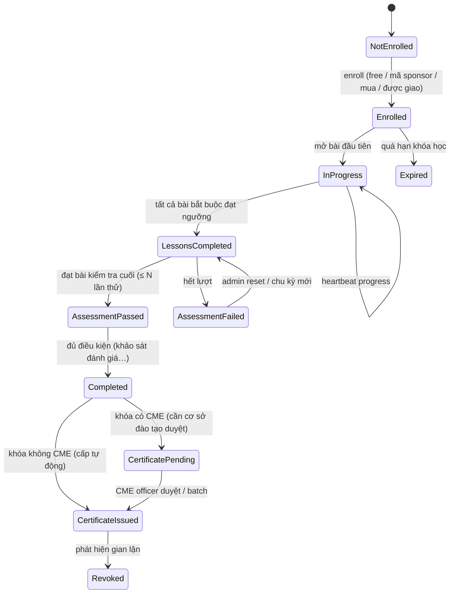

# 02. Phạm vi sản phẩm & Business logic

## 1. Các nhóm người dùng (personas)

| Persona | Mục tiêu | Ghi chú |
|---|---|---|
| **Learner chưa xác thực** | Xem nội dung công khai, đăng ký | Không xem nội dung thuốc kê đơn, không nhận CME |
| **HCP đã xác thực** (BS, DS, ĐD, KTV…) | Học, tích lũy CME/CPE, hỏi chuyên gia | Thuộc tính: nghề, chuyên khoa, số CCHN, tỉnh/thành, nơi công tác |
| **Sinh viên y dược** | Học, luyện quiz | Xác thực bằng thẻ sinh viên. Không đủ điều kiện CME |
| **Chủ/nhân viên nhà thuốc (khách thuocsi.vn)** | Đào tạo GPP, sản phẩm, CPE | Liên kết với tài khoản khách hàng Buymed |
| **Diễn giả / Giảng viên** | Đăng bài giảng, trả lời Q&A | Có thể là KOL bên ngoài |
| **Org admin / Content editor** (đối tác: hãng dược, hội, BV) | Quản lý kênh, khóa học, webinar, xem báo cáo | Chỉ trong phạm vi tổ chức của mình |
| **Medical/Legal reviewer (MLR)** | Duyệt nội dung trước khi xuất bản | Bắt buộc với nội dung có tài trợ hoặc thông tin thuốc |
| **Cán bộ cơ sở đào tạo CME** | Cấu hình yêu cầu CME, duyệt cấp chứng chỉ, xuất danh sách | Đơn vị chịu trách nhiệm pháp lý về chứng chỉ |
| **Sponsor analyst** | Xem báo cáo tổng hợp | Không xem PII trừ khi có consent |
| **Platform ops** (admin, KYC officer, moderator, support, finance) | Vận hành nền tảng | |

## 2. Module chức năng

## 3. User journey chính

### 3.1 Onboarding và xác thực HCP

**Quy tắc KYC:**
- Một số CCHN chỉ gắn với một tài khoản. Trùng số thì đánh dấu nghi vấn.
- Ảnh giấy tờ lưu ở bucket private, mã hóa, truy cập có audit, có thời hạn lưu (retention) theo chính sách dữ liệu.
- Xác thực có **hạn hiệu lực** (ví dụ xác thực lại theo chu kỳ hoặc khi đổi nghề).
- Trạng thái: `none → pending → approved | rejected | need_more_info → (expired)`.

### 3.2 Học khóa học có CME

## 4. Quy tắc nghiệp vụ chi tiết

### 4.1 Nội dung và vòng đời
- Cấp bậc: `Organization (kênh) → Program (tùy chọn, ví dụ chuỗi 2024) → Course → Section → Lesson → Asset (video, PDF, slide, SCORM, bài viết)`.
- **Vòng đời course:** `draft → in_review (MLR) → approved → published → (unpublished | archived)`. Sửa nội dung đã publish thì tạo **version mới**. Người đang học giữ version cũ hoặc được migrate theo cấu hình. Chứng chỉ luôn ghi version.
- **Visibility:** `public` | `registered` | `verified_hcp` | `hcp_type in (...)` | `org_members` | `invite_only`. Nội dung thông tin thuốc kê đơn bắt buộc từ `verified_hcp` trở lên.
- **Gắn nhãn tài trợ:** course có `sponsor_org_id` thì UI phải hiển thị "Nội dung được tài trợ bởi …". Tách biệt rõ với nội dung chuyên môn độc lập.

### 4.2 Theo dõi tiến độ (anti-cheat cho CME)
- Player gửi **heartbeat** mỗi 10–15 giây gồm `(lesson_id, position, playback_rate, visible)`. Server cộng dồn **khoảng thời gian đã xem thực** (hợp các đoạn `[start, end]`), không tin `position` từ client.
- Bài hoàn thành khi `watched_ratio ≥ threshold` (mặc định 90% với khóa CME, 70% với khóa thường). Chặn tua vượt phần chưa xem với khóa CME. Giới hạn tốc độ phát (ví dụ ≤ 1.5x) tùy chính sách.
- Phát hiện bất thường: nhiều phiên song song, heartbeat đều tăm tắp suốt nhiều giờ, hoàn thành nhanh hơn thời lượng video. Gắn cờ để review, không auto‑revoke.
- Tài liệu PDF/slide: hoàn thành theo số trang đã xem hoặc thời gian tối thiểu.

### 4.3 Đánh giá (Assessment)
- Ngân hàng câu hỏi theo chủ đề và độ khó. Loại câu: single choice, multi choice, true/false, matching, case-based (tình huống lâm sàng nhiều câu).
- Đề thi: cố định hoặc **random theo blueprint** (n câu mỗi chủ đề và độ khó), trộn đáp án.
- Cấu hình: `pass_score`, `max_attempts`, `time_limit`, `cooldown_between_attempts`, có hiện đáp án hay không và hiện khi nào.
- **Chấm điểm phía server**. Đáp án đúng không bao giờ gửi xuống client trước khi nộp.
- Lưu snapshot đề và câu trả lời của từng attempt (bằng chứng khi đối soát CME).

### 4.4 Chứng chỉ (Certificate)
- Hai loại: **Giấy chứng nhận hoàn thành** (nền tảng hoặc tổ chức cấp) và **Chứng chỉ CME/CPE** (do **cơ sở đào tạo liên tục đủ điều kiện** cấp; nền tảng chỉ lưu và hiển thị).
- Thuộc tính: `serial_no` (duy nhất, theo format của đơn vị cấp), người nhận (họ tên, ngày sinh, số CCHN snapshot), khóa học và version, số tiết/giờ, ngày cấp, đơn vị cấp, chữ ký (ảnh hoặc **chữ ký số** nếu yêu cầu), `verify_url` (QR).
- Sinh PDF bằng worker và lưu bất biến (immutable). Thu hồi thì `revoked_at` cộng lý do; trang verify hiển thị trạng thái.
- Trang **verify công khai** chỉ hiện thông tin tối thiểu (tên, khóa, ngày, trạng thái).

### 4.5 Sổ CME/CPE (credit ledger)
- Bảng **append-only** `cme_credit_entries(user_id, provider_org_id, activity_id, credits, credit_type, issued_at, certificate_id, period)`.
- Dashboard người học: "Đã tích lũy X / yêu cầu Y tiết trong chu kỳ 5 năm" (Y cấu hình theo nghề và theo quy định hiện hành).
- Cho phép người học **khai báo CME ngoài nền tảng** (upload chứng chỉ, trạng thái `self_reported`) để có bức tranh đầy đủ.
- Xuất danh sách cho cơ sở đào tạo (Excel/CSV theo mẫu) và đối soát.

> ⚖️ **Cần legal xác minh:** khung đào tạo liên tục hiện hành (Luật Khám bệnh, chữa bệnh 2023 và văn bản hướng dẫn; quy định đào tạo liên tục ngành Dược). Các điểm cần xác minh: số tiết yêu cầu, điều kiện "cơ sở đào tạo liên tục", tính hợp lệ của hình thức trực tuyến, và yêu cầu lưu hồ sơ. Các thông tư cũ (22/2013, 26/2020) được nhiều nguồn nhắc tới nhưng có thể đã được thay thế.

### 4.6 Webinar / Live (Phase 2)
- Vòng đời: `scheduled → registration_open → live → ended → processing → replay_published (gắn vào course)`.
- Đăng ký trước, nhắc lịch (email, Zalo, push). Link tham dự **gắn theo user** (không chia sẻ link chung).
- **Điểm danh cho CME:** join/leave log và tổng thời lượng tham dự ≥ ngưỡng, kèm câu hỏi kiểm tra chú ý (attention check) hoặc poll giữa buổi.
- Q&A và poll trong buổi. Câu hỏi chưa trả lời chuyển sang Q&A của bài học replay.

### 4.7 Cộng đồng & Q&A (Phase 2)
- Group: `public | private (duyệt tham gia) | secret`. Vai trò group: owner, moderator, member.
- Q&A theo bài học: học viên hỏi, diễn giả hoặc moderator trả lời, đánh dấu "câu trả lời của chuyên gia".
- Kiểm duyệt: báo cáo vi phạm, lọc từ khóa, hàng đợi duyệt. **Không cho phép đăng thông tin bệnh nhân nhận dạng được** (cảnh báo khi post và quy trình gỡ bài).

### 4.8 Ghi danh & thương mại
- Cách ghi danh: miễn phí tự do, **mã tài trợ** (voucher do nhà tài trợ phát, giới hạn số lượng/đối tượng), mua lẻ, gói thuê bao, **được giao** (org admin hoặc trình dược viên giao cho danh sách nhà thuốc), import danh sách.
- Thanh toán (nếu có): đơn hàng → cổng thanh toán → webhook → ghi danh. Xuất hóa đơn điện tử qua nhà cung cấp.
- Hoàn tiền và hủy theo chính sách.

### 4.9 Báo cáo
| Đối tượng | Nội dung | Mức dữ liệu |
|---|---|---|
| Learner | tiến độ, điểm, chứng chỉ, CME | của chính mình |
| Org admin | enroll, completion, điểm, drop-off theo bài | dữ liệu dòng **chỉ** của khóa thuộc org, theo phạm vi consent |
| Sponsor | reach, completion rate, phân bố nghề và tỉnh, NPS | **chỉ tổng hợp**, ẩn nhóm có n < k (ví dụ k = 10) |
| CME officer | danh sách đủ điều kiện, attempt, log tham dự | dữ liệu dòng của hoạt động mình bảo trợ |
| Platform | toàn bộ, kèm audit | |

## 5. Yêu cầu tuân thủ ảnh hưởng tới thiết kế

| Chủ đề | Tác động thiết kế |
|---|---|
| Bảo vệ dữ liệu cá nhân (NĐ 13/2023/NĐ-CP; Luật BVDLCN 2025 hiệu lực từ 2026, cần legal xác nhận) | Consent theo mục đích (học tập, chia sẻ với nhà tài trợ, marketing), quyền xem/xóa/rút consent, đánh giá tác động xử lý dữ liệu, hồ sơ chuyển dữ liệu ra nước ngoài nếu host ngoài VN, thông báo sự cố |
| Thông tin thuốc cho người hành nghề (Luật Dược và văn bản hướng dẫn) | Gating `verified_hcp`, nhãn tài trợ, quy trình MLR, lưu bản đã duyệt |
| Đào tạo liên tục y/dược | Sổ CME, bằng chứng tham dự, vai trò cơ sở đào tạo, mẫu chứng chỉ |
| Hóa đơn điện tử | Tích hợp nhà cung cấp hóa đơn |
| An toàn thông tin | Mã hóa, audit log, phân quyền tối thiểu, pentest trước go-live |
