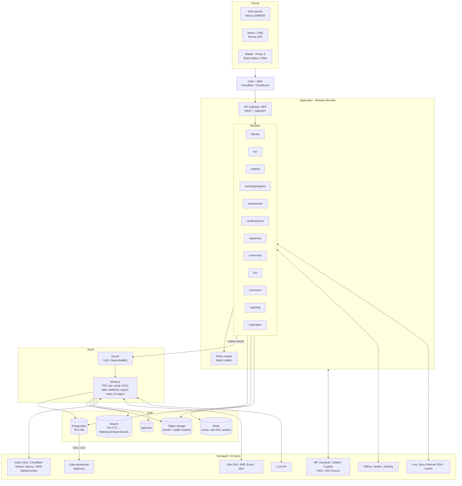

# 03. Kiến trúc & Hạ tầng

## 1. Build vs Buy

| Lựa chọn | Ưu | Nhược | Kết luận |
|---|---|---|---|
| **Moodle / Open edX** (open-source LMS) | Có sẵn course, quiz, gradebook, SCORM | UX cũ, khó tùy biến KYC/CME/sponsor/community, PHP/Python legacy, khó tích hợp sâu thuocsi | Chỉ hợp cho **pilot nội bộ** vài tuần |
| **SaaS LMS** (TalentLMS, Docebo…) | Nhanh | Dữ liệu ở bên thứ ba, không làm được mạng HCP và mô hình kênh tài trợ, phí theo user | Không phù hợp mục tiêu "làm nền tảng" |
| **Custom build + dịch vụ managed** | Kiểm soát dữ liệu, khác biệt hóa, tích hợp hệ sinh thái | Tốn effort ban đầu | ✅ **Đề xuất** |

**Mua (managed):** video transcoding và streaming, live/webinar, OTP/SMS/Zalo ZNS, email, cổng thanh toán, hóa đơn điện tử, LLM API, error tracking.
**Tự build:** identity và profile HCP, KYC, catalog, progress, assessment, certificate, CME ledger, org/tenant, phân quyền, sponsor reporting, CMS.

## 2. Kiến trúc tổng thể (đề xuất)

### Tại sao Modular Monolith?
- Team giai đoạn đầu nhỏ (5–10 dev). Microservice làm tăng chi phí vận hành, tracing, transaction phân tán.
- Domain còn đang khám phá, ranh giới module sẽ còn thay đổi. Refactor trong một repo rẻ hơn nhiều.
- **Quy tắc:** mỗi module có schema DB riêng (`identity`, `learning`, `assessment`…), chỉ gọi nhau qua interface hoặc service public và domain event, **không join chéo schema trong code nghiệp vụ** (reporting dùng view hoặc warehouse). Như vậy sau này tách service được.
- Ứng viên tách sớm nếu cần: **progress ingestion** (heartbeat ghi nhiều), **notification**, **AI**.

## 3. Lựa chọn stack

### 3.1 Frontend
| Hạng mục | Đề xuất | Lý do |
|---|---|---|
| Framework | **Next.js (App Router) + TypeScript** | SSR/ISR cho trang khóa học, bài viết, profile công khai (SEO là kênh acquisition chính). Một framework cho cả learner và admin |
| UI | Tailwind + shadcn/ui (Radix), design system riêng | Nhanh, accessible |
| Data | TanStack Query, client sinh từ OpenAPI | Type-safe end-to-end |
| Form | React Hook Form + Zod | Schema dùng chung FE và BE |
| Player | Video.js / hls.js, hoặc player của nhà cung cấp video (Mux Player…) | Hỗ trợ HLS, signed URL, chặn tua, phát heartbeat |
| i18n | next-intl (vi mặc định, en sau) | |
| Monorepo | Turborepo / Nx: `apps/web`, `apps/admin`, `apps/api`, `packages/ui`, `packages/schemas` | |
| Mobile | Phase 3: PWA trước, React Native (Expo) sau nếu cần offline, push | Tái dùng logic TS |

### 3.2 Backend
| Hạng mục | Đề xuất | Ghi chú |
|---|---|---|
| Runtime | **Node.js + NestJS (TypeScript)** | Chung ngôn ngữ với FE, module system hợp modular monolith. *Nếu team Buymed sẵn mạnh Go/Java thì ưu tiên stack của team.* |
| ORM / SQL | Drizzle hoặc Prisma (hoặc Kysely) + migration có version | Cần hỗ trợ `SET LOCAL` trong transaction cho RLS |
| API | REST + OpenAPI 3.1. Webhook ký HMAC cho đối tác | GraphQL không cần ở MVP |
| Async | Transactional **outbox** → SQS / BullMQ | Đảm bảo event không mất |
| Authn | OIDC (IdP riêng), access token ngắn hạn + refresh token xoay vòng, cookie httpOnly cho web | |
| Authz | Policy layer trong code (CASL / Cerbos / tự viết) + **PostgreSQL RLS** | Xem tài liệu 05 |

### 3.3 Phương án nhanh: Supabase
Nếu cần MVP rất nhanh (≤ 8 tuần) với team nhỏ: **Supabase** (Postgres + Auth + Storage + RLS + Realtime + Edge Functions) + Next.js.
- ✅ RLS là cơ chế phân quyền gốc, ít backend code.
- ⚠️ Business logic phức tạp (CME, anti-cheat, chấm thi, sponsor reporting, SSO thuocsi) sẽ dồn vào SQL function và edge function, khó test và khó quản trị khi lớn. Cần cân nhắc vendor lock-in và vị trí lưu dữ liệu.
- **Khuyến nghị:** dùng Supabase cho **prototype hoặc pilot**. Bản production nên theo kiến trúc custom ở trên (vẫn dùng Postgres + RLS nên migrate được).

## 4. Video

| Phương án | Ưu | Nhược |
|---|---|---|
| **Mux / Cloudflare Stream / Bunny Stream** (managed) | Upload → HLS tự động, signed playback, analytics, có player | Phí theo phút lưu trữ và phút xem |
| AWS S3 + MediaConvert + CloudFront signed cookies | Rẻ hơn ở quy mô lớn, kiểm soát hoàn toàn | Tự vận hành pipeline, player, DRM |
| YouTube unlisted | Rẻ | Không kiểm soát truy cập, không hợp với nội dung HCP-only |

**Đề xuất:** managed (Mux, Cloudflare Stream hoặc Bunny; chọn theo PoC đo độ trễ từ VN và chi phí). Trừu tượng hóa qua interface `VideoProvider` để có thể đổi sau.
- Upload trực tiếp từ admin lên provider (direct upload URL). Webhook `asset.ready` cập nhật lesson.
- **Signed playback token** ngắn hạn (5–15 phút) gắn `user_id`. Watermark động (tên/SĐT) cho nội dung nhạy cảm. DRM (Widevine/FairPlay) chỉ khi đối tác yêu cầu.
- Phụ đề/transcript: ASR (Whisper hoặc dịch vụ cloud) giúp accessibility, search và AI.

**Ước tính chi phí:** `chi phí/tháng ≈ phút lưu trữ × đơn giá lưu + (số người xem × phút xem TB) × đơn giá delivery`. Delivery chiếm phần lớn, nên cần PoC với số liệu thực.

## 5. Live / Webinar

| Phương án | Khi nào |
|---|---|
| **Zoom Webinar / Meeting SDK + API** | Đối tác dược và hội quen dùng Zoom. Báo cáo tham dự qua API. Nhanh nhất |
| **LiveKit (self-host hoặc cloud) / Agora** | Muốn trải nghiệm in-platform, kiểm soát điểm danh và tương tác |
| Low-latency HLS (Mux Live, Cloudflare Stream Live) + chat riêng | Hội thảo quy mô lớn (1 người nói, hàng nghìn người xem) |

**Đề xuất:** Phase 2 bắt đầu với **Zoom tích hợp** (đăng ký qua platform, link cá nhân hóa, đồng bộ attendance report) hoặc **HLS live + Q&A/poll tự build**. Đánh giá LiveKit sau.

## 6. Search, Library, AI

- **Giai đoạn 1:** PostgreSQL full‑text search + extension `unaccent` (tìm tiếng Việt không dấu) + `pg_trgm`.
- **Giai đoạn 2 (Library):** Meilisearch hoặc OpenSearch (tokenizer tiếng Việt), index course, lesson, transcript, tài liệu, guideline. Kết quả **lọc theo quyền** (gắn `visibility`, `org_id`, `hcp_types` vào document và filter lúc query).
- **AI tutor (Phase 3):** RAG trên **kho nội dung đã duyệt**. Pipeline: chunk, embed, lưu `pgvector`. Câu trả lời **bắt buộc trích dẫn nguồn** (bài học hoặc guideline) và có disclaimer "không thay thế phán đoán lâm sàng". Lọc quyền ở retrieval. Log hỏi đáp để đánh giá chất lượng. Không cho upload dữ liệu bệnh nhân. Tính năng: hỏi đáp tài liệu, tóm tắt bài, sinh câu hỏi ôn tập (cần duyệt nếu dùng cho thi chính thức).

## 7. Hạ tầng cloud

### 7.1 Vị trí dữ liệu
- Dữ liệu HCP (CCHN, nơi công tác) là dữ liệu cá nhân, có thể thuộc nhóm nhạy cảm theo quy định mới. Phương án: **host tại VN** (Viettel IDC, FPT Cloud, VNG Cloud, CMC) **hoặc** cloud quốc tế region Singapore kèm hồ sơ chuyển dữ liệu xuyên biên giới. **Cần legal quyết định ở Phase 0.**
- Nếu Buymed đã có cloud chuẩn (AWS hoặc GCP) và landing zone thì nên dùng chung để tận dụng IAM, network, logging, security baseline.

### 7.2 Topology tham chiếu (ví dụ trên AWS; GCP tương đương)
| Thành phần | Dịch vụ |
|---|---|
| DNS, CDN, WAF, DDoS | Cloudflare hoặc CloudFront + AWS WAF |
| Web (Next.js) | ECS Fargate / EKS (hoặc Vercel nếu chấp nhận dữ liệu render ngoài) |
| API + Workers | ECS Fargate / EKS. Autoscale theo CPU và độ dài queue |
| DB | RDS/Aurora PostgreSQL Multi-AZ, PITR, read replica cho reporting |
| Pooling | RDS Proxy / PgBouncer (**transaction mode**, tương thích `SET LOCAL`) |
| Cache | ElastiCache Redis |
| Storage | S3: `public-assets` (qua CDN), `private-docs` (KYC, SSE-KMS), `certificates` (Object Lock) |
| Queue | SQS (+ DLQ) |
| Secrets | Secrets Manager / Vault |
| IaC | Terraform. Môi trường `dev`, `staging`, `prod` tách account/project |
| CI/CD | GitHub Actions: lint, typecheck, test, **test RLS (pgTAP)**, build image, migrate, deploy (blue/green hoặc rolling) |

### 7.3 Observability & Security
- OpenTelemetry (trace, metric, log) gửi về Grafana stack hoặc Datadog. Sentry cho FE/BE. Uptime check.
- Audit log bất biến cho: đăng nhập, KYC, đổi quyền, xuất dữ liệu, cấp hoặc thu hồi chứng chỉ, sửa điểm.
- OWASP ASVS L2 làm checklist. Rate limit (OTP, login, heartbeat). Bot protection cho đăng ký. Pentest trước go-live. Backup và diễn tập restore hàng quý.

## 8. Yêu cầu phi chức năng (giả định ban đầu, cần chốt)

| Hạng mục | Mục tiêu MVP | Ghi chú |
|---|---|---|
| Người dùng đăng ký | 50k–200k trong năm đầu | Doccen công bố khoảng 10k+ user và 80k lượt người học |
| Đồng thời (học thường) | 1–3k | |
| Peak webinar | 5–10k người xem | Live chạy trên provider, platform chỉ chịu tải đăng ký, Q&A, heartbeat |
| Heartbeat | Khoảng 3k users × 1 req/15s ≈ 200 RPS | Ghi vào Redis, flush theo batch vào PG |
| Uptime | 99.5% (MVP) → 99.9% | |
| p95 API | < 300 ms | |
| RPO / RTO | ≤ 15 phút / ≤ 4 giờ | |
| Tương thích | Mobile web trước. Android tầm trung, mạng 4G | Đa số HCP và nhà thuốc học trên điện thoại |
