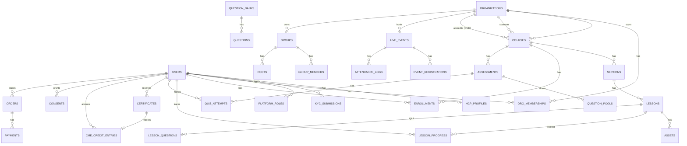

# 04. Database & Row Level Security (RLS)

> Prototype chạy được: [`sql/001_schema_rls.sql`](../sql/001_schema_rls.sql) và bộ test [`sql/test_rls.sql`](../sql/test_rls.sql) (22 kịch bản, đã chạy pass trên PostgreSQL 16).
> ```bash
> createdb lms_proto
> psql -q -v ON_ERROR_STOP=1 -d lms_proto -f sql/001_schema_rls.sql -f sql/test_rls.sql
> ```

## 1. Vì sao chọn PostgreSQL

- Dữ liệu LMS có **quan hệ chặt** (user, enrollment, course, lesson, attempt, certificate) và cần **transaction** (chấm thi xong mới cấp chứng chỉ và ghi sổ CME).
- **RLS native** cho multi-tenant và phân quyền dòng. JSONB cho dữ liệu bán cấu trúc (snapshot đề thi, metadata). `pgvector` cho AI. FTS + `unaccent` cho tìm kiếm tiếng Việt giai đoạn đầu.
- Hệ sinh thái managed tốt (RDS/Aurora, Cloud SQL, Supabase, VN cloud đều có).

## 2. Mô hình dữ liệu (ERD rút gọn)



### Nhóm bảng theo module (schema riêng)

| Schema | Bảng chính |
|---|---|
| `identity` | users, auth_identities (phone, email, google, thuocsi_sso), hcp_profiles, kyc_submissions, consents |
| `org` | organizations, org_memberships, platform_roles, invitations |
| `catalog` | courses, course_versions, sections, lessons, assets, categories, tags, course_tags |
| `learning` | enrollments, lesson_progress, progress_segments (raw heartbeat, partition theo tháng), notes, bookmarks |
| `assessment` | question_banks, questions, options, assessments, assessment_blueprints, quiz_attempts, attempt_answers |
| `credential` | certificate_templates, certificates, cme_credit_entries (append-only), cme_requirements |
| `live` | live_events, event_registrations, attendance_logs, polls, poll_responses |
| `community` | groups, group_members, posts, comments, reactions, lesson_questions, reports |
| `commerce` | products, prices, vouchers, voucher_redemptions, orders, payments, invoices |
| `ops` | audit_logs (append-only), outbox_events, notifications, feature_flags |

### Quy ước
- PK `uuid` (UUIDv7 để index tuần tự). `created_at`, `updated_at` ở mọi bảng. Soft delete (`deleted_at`) cho nội dung. **Không soft delete** cho ledger.
- **Append-only** cho `cme_credit_entries`, `audit_logs`, `attempt_answers`: chỉ GRANT `INSERT, SELECT`. Muốn sửa thì ghi bút toán điều chỉnh.
- Snapshot dữ liệu tại thời điểm cấp (họ tên, số CCHN, version khóa học) vào certificate. Không join động.
- PII nhạy cảm (`license_no`, ảnh giấy tờ) mã hóa ở tầng ứng dụng (envelope encryption, KMS) hoặc `pgcrypto`. Tìm kiếm trùng số CCHN qua **blind index** (HMAC của số đã chuẩn hóa).
- Bảng ghi nhiều (`progress_segments`, `attendance_logs`, `audit_logs`) **partition theo thời gian**.

## 3. Chiến lược RLS

### 3.1 Nguyên tắc
1. **RLS là lớp phòng thủ thứ hai, không phải lớp duy nhất.** API vẫn kiểm tra quyền (policy layer). RLS đảm bảo lỗi code (quên `WHERE org_id = …`, IDOR) không làm lộ dữ liệu.
2. **Ngữ cảnh người dùng truyền qua `SET LOCAL`** trong mỗi transaction:
   ```sql
   begin;
   select set_config('app.user_id', $1, true);  -- true = chỉ trong transaction này
   -- ... các truy vấn của request ...
   commit;
   ```
   Tương thích PgBouncer/RDS Proxy ở **transaction mode**. Tuyệt đối không dùng `SET` cấp session với pool.
3. **Ba role DB:**
   | Role | Dùng cho | RLS |
   |---|---|---|
   | `app_owner` | migration, sở hữu bảng | bỏ qua (owner), không dùng ở runtime |
   | `app_user` | API xử lý request người dùng | **áp dụng** |
   | `app_worker` | job hệ thống: chấm điểm, cấp chứng chỉ, flush progress | `BYPASSRLS`, code được review chặt, chỉ chạy trong worker |
4. **GRANT quyết định bảng và cột, RLS quyết định dòng.** Ví dụ learner không có `GRANT UPDATE` trên `enrollments.status`, nên không thể tự đánh dấu hoàn thành dù policy cho phép thấy dòng.
5. **Helper function `SECURITY DEFINER`** (`app.has_org_role`, `app.course_visible`…) đọc bảng phân quyền mà không kích hoạt RLS lồng nhau. Như vậy tránh đệ quy policy và tập trung logic ABAC một chỗ. Luôn `set search_path` để tránh hijack.
6. **Truy cập đặc biệt qua "cửa sổ hẹp"**: function trả về đúng cột cần. Ví dụ `app.verify_certificate(serial)` cho trang verify công khai, `app.sponsor_course_stats()` cho báo cáo tài trợ chỉ trả số tổng hợp và ẩn nhóm có n < k.

### 3.2 Bảng tóm tắt policy

| Bảng | SELECT | INSERT | UPDATE |
|---|---|---|---|
| users | chính mình; platform admin/support/KYC | (qua auth service) | chính mình (cột hạn chế) |
| hcp_profiles | chính mình; KYC officer | chính mình, `status=none` | **chỉ KYC officer** |
| courses | `app.course_visible()` = staff của org **hoặc** published + (public / registered / verified_hcp đúng nghề / org_members / invite đã ghi danh) | org_admin/editor, `status=draft` | editor (draft/in_review), MLR (approved), org_admin (publish) |
| lessons | khi thấy course | org_admin/editor | org_admin/editor |
| enrollments | chính mình; org_admin/instructor/analyst của org; CME officer của cơ sở bảo trợ | tự ghi danh khóa `open` mà mình thấy; org_admin giao | **chỉ worker** |
| lesson_progress, quiz_attempts | chính mình; staff khóa | **chỉ worker** | **chỉ worker** |
| certificates | chính mình; issuer; platform | **chỉ worker** | **chỉ worker** (revoke) |
| kyc_submissions | chính mình; KYC officer | chính mình, `pending` | KYC officer, `reviewed_by = mình` |
| Báo cáo sponsor | **không có quyền dòng**, chỉ qua function tổng hợp | | |

### 3.3 Ví dụ trích từ prototype

```sql
-- ABAC: ai được thấy khóa học
create function app.course_visible(p_course uuid, p_status text, p_visibility text,
                                   p_org uuid, p_hcp_types text[]) returns boolean
language sql stable security definer set search_path = pg_catalog, lms as $$
  select
    app.has_org_role(p_org, array['org_admin','content_editor','instructor','mlr_reviewer','cme_officer','analyst'])
    or app.has_platform_role(array['platform_admin','moderator','support'])
    or (p_status = 'published' and (
          p_visibility = 'public'
       or (p_visibility = 'registered'   and app.uid() is not null)
       or (p_visibility = 'verified_hcp' and app.current_hcp_type() is not null
                                         and app.current_hcp_type() <> 'student'
                                         and (p_hcp_types is null or app.current_hcp_type() = any(p_hcp_types)))
       or (p_visibility = 'org_members'  and app.has_org_role(p_org, array['member', ...]))
       or (p_visibility = 'invite_only'  and exists (select 1 from lms.enrollments e
                                                    where e.user_id = app.uid() and e.course_id = p_course))))
$$;

create policy courses_read on lms.courses for select
  using (app.course_visible(id, status, visibility, org_id, allowed_hcp_types));

-- Editor không thể tự publish: WITH CHECK chặn trạng thái mới
create policy courses_update on lms.courses for update
  using (app.has_org_role(org_id, array['org_admin','content_editor','mlr_reviewer']))
  with check (
       (status in ('draft','in_review') and app.has_org_role(org_id, array['org_admin','content_editor']))
    or (status = 'approved'          and app.has_org_role(org_id, array['mlr_reviewer']))
    or app.has_org_role(org_id, array['org_admin']));
```

### 3.4 Kết quả test (prototype)

```
PASS  anon chỉ thấy khóa public đã publish
PASS  unverified KHÔNG thấy khóa verified_hcp
PASS  unverified KHÔNG thấy lesson của khóa HCP
PASS  pharmacist verified thấy khóa HCP dành cho dược sĩ
PASS  pharmacist KHÔNG thấy bản nháp
PASS  pharmacist tự ghi danh được
PASS  không ghi danh hộ người khác
PASS  learner không tự set completed (không có GRANT UPDATE)
PASS  learner không tự duyệt KYC (0 dòng bị ảnh hưởng)
PASS  doctor KHÔNG thấy khóa allowed_hcp_types = pharmacist
PASS  student KHÔNG thấy nội dung verified_hcp
PASS  editor thấy bản nháp của org mình
PASS  editor không tự publish được
PASS  editor KHÔNG xem được enrollment (không có vai trò analyst/admin)
PASS  sponsor analyst KHÔNG đọc được dữ liệu dòng enrollment
PASS  sponsor analyst KHÔNG đọc được hcp_profiles
PASS  sponsor thấy số liệu tổng hợp (nhóm ≥ k)
PASS  sponsor không xem báo cáo khóa không tài trợ
PASS  CME officer thấy enrollment khóa mình bảo trợ
PASS  CME officer KHÔNG thấy enrollment khóa khác
PASS  KYC officer duyệt được hồ sơ
PASS  sau khi duyệt KYC, user thấy khóa HCP
```

## 4. Hiệu năng và bẫy thường gặp của RLS

| Vấn đề | Cách xử lý |
|---|---|
| Hàm trong policy chạy **mỗi dòng** | Bọc hàm không phụ thuộc dòng trong `(select fn())` để planner tạo InitPlan. Đánh dấu `STABLE` |
| `has_org_role` gọi lặp với nhiều org | Index `(user_id, org_id, role)`. Khi scale: tính sẵn danh sách quyền lúc mở transaction (`set_config('app.org_roles', '<json>', true)`) và đọc từ setting thay vì query |
| Danh sách lớn (catalog) chậm | Kết hợp **filter tường minh ở query** (`where status='published' and org_id = …`) với RLS. Planner dùng index, RLS chỉ còn là chốt chặn |
| Reporting nặng chạy qua RLS | Chạy trên **read replica / warehouse** bằng view tổng hợp riêng. Không chạy dashboard qua `app_user` |
| Quên bật RLS ở bảng mới | CI check: mọi bảng trong schema nghiệp vụ phải `relrowsecurity = true` (query `pg_class`) |
| Worker `BYPASSRLS` bị lạm dụng | Worker chỉ có quyền tối thiểu (GRANT theo bảng), mọi thao tác ghi audit log, code review bắt buộc |
| `SECURITY DEFINER` bị hijack search_path | Luôn `set search_path = pg_catalog, <schema>`. Revoke `CREATE` trên schema public |
| Test | pgTAP trong CI, ma trận *persona × bảng × thao tác* như `test_rls.sql` |

## 5. Phương án nếu dùng Supabase
Cùng mô hình. Thay `app.uid()` bằng `auth.uid()` (lấy từ JWT), role `authenticated` thay cho `app_user`, worker dùng `service_role`. Policy và helper function giữ nguyên.
