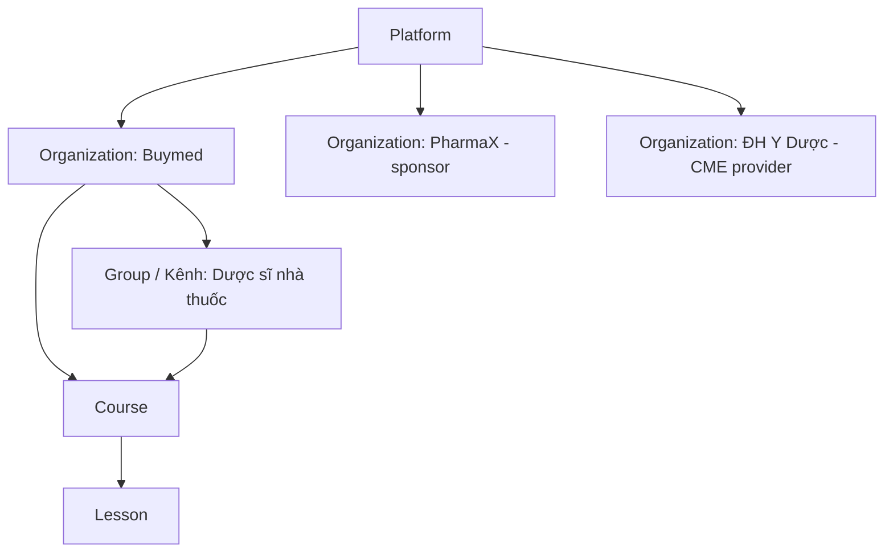
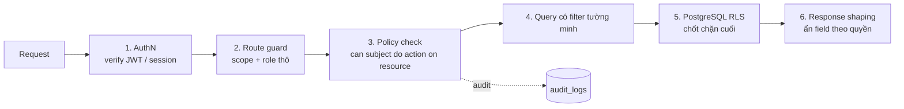

# 05. RBAC & Phân quyền

## 1. Mô hình: RBAC theo phạm vi + ABAC + quan hệ

Một quyết định phân quyền trả lời câu hỏi: **Subject** (ai, có vai trò gì, ở phạm vi nào, thuộc tính gì) có được **Action** trên **Resource** (thuộc org nào, trạng thái, visibility) trong **Context** (thời gian, IP, kênh) hay không.

| Lớp | Câu hỏi | Ví dụ |
|---|---|---|
| **RBAC theo phạm vi (scoped roles)** | Bạn giữ vai trò gì, **ở đâu**? | `content_editor` @ org Buymed. `moderator` @ group "Dược lâm sàng" |
| **ABAC (thuộc tính)** | Thuộc tính của bạn và tài nguyên có khớp không? | `hcp_type = pharmacist` và `verified` và khóa `visibility = verified_hcp`, `allowed_hcp_types ∋ pharmacist` |
| **ReBAC (quan hệ)** | Bạn có quan hệ với tài nguyên không? | Đã ghi danh khóa, là thành viên group, là diễn giả của bài học, là người tạo post |

## 2. Phạm vi (scope) và vai trò

### 2.1 Platform roles (nhân sự vận hành)
| Role | Quyền chính |
|---|---|
| `super_admin` | Toàn quyền, bao gồm cấu hình hệ thống. Tối đa 2–3 người, bắt buộc MFA, có break-glass log |
| `platform_admin` | Quản lý org, user, cấu hình, xem mọi nội dung |
| `kyc_officer` | Xem giấy tờ KYC, duyệt hoặc từ chối xác thực HCP |
| `moderator` | Ẩn hoặc xóa post/comment, xử lý báo cáo vi phạm |
| `support` | Xem hồ sơ user, enrollment, reset tiến độ (có lý do và audit), **không** xem giấy tờ KYC |
| `finance` | Đơn hàng, thanh toán, hóa đơn, đối soát |

### 2.2 Organization roles (tenant / kênh đối tác)
| Role | Quyền chính |
|---|---|
| `org_owner` | Mọi quyền trong org, quản lý admin, hợp đồng |
| `org_admin` | Quản lý thành viên, publish khóa học, giao khóa, xem báo cáo dòng (theo consent) |
| `content_editor` | Tạo và sửa khóa học, bài học, ngân hàng câu hỏi (draft, in_review) |
| `instructor` (diễn giả) | Sửa bài học được gán, trả lời Q&A, xem tiến độ học viên khóa mình dạy |
| `mlr_reviewer` | Duyệt nội dung (medical/legal/regulatory), chuyển `approved` hoặc trả về |
| `cme_officer` | (thuộc cơ sở đào tạo) cấu hình yêu cầu CME, duyệt cấp chứng chỉ, xuất danh sách |
| `analyst` | Xem báo cáo của org. Với org tài trợ thì **chỉ số tổng hợp** |
| `member` | Thành viên org (ví dụ nhân viên nội bộ, nhà thuốc thuộc chương trình), thấy nội dung `org_members` |

### 2.3 Group roles (cộng đồng)
`group_owner`, `group_moderator`, `group_member`, cùng trạng thái `pending` cho group private.

### 2.4 Learner (không phải "role" mà là thuộc tính)
`registered` → `verified_hcp {doctor | pharmacist | nurse | technician | midwife}` hoặc `student`. Có `verified_until`, `specialty`, `province`.

## 3. Ma trận quyền (rút gọn)

| Action \ Role | Learner | Verified HCP | Instructor | Editor | MLR | Org admin | CME officer | Sponsor analyst | KYC officer | Platform admin |
|---|---|---|---|---|---|---|---|---|---|---|
| Xem khóa public/registered | ✅ | ✅ | ✅ | ✅ | ✅ | ✅ | ✅ | ✅ | ✅ | ✅ |
| Xem khóa `verified_hcp` | ❌ | ✅ đúng nghề | org mình | org mình | org mình | org mình | khóa bảo trợ | ❌ | ❌ | ✅ |
| Tạo/sửa draft | ❌ | ❌ | bài được gán | ✅ | ❌ | ✅ | ❌ | ❌ | ❌ | ✅ |
| Duyệt nội dung (approved) | ❌ | ❌ | ❌ | ❌ | ✅ | ✅ | ❌ | ❌ | ❌ | ✅ |
| Publish | ❌ | ❌ | ❌ | ❌ | ❌ | ✅ | ❌ | ❌ | ❌ | ✅ |
| Xem tiến độ học viên (dòng) | mình | mình | khóa mình dạy | ❌ | ❌ | ✅ (consent) | khóa bảo trợ | ❌ | ❌ | ✅ |
| Báo cáo tổng hợp | ❌ | ❌ | khóa mình | ❌ | ❌ | ✅ | ✅ | khóa tài trợ | ❌ | ✅ |
| Cấp / thu hồi chứng chỉ CME | ❌ | ❌ | ❌ | ❌ | ❌ | không CME | ✅ | ❌ | ❌ | ✅ (audit) |
| Duyệt KYC | ❌ | ❌ | ❌ | ❌ | ❌ | ❌ | ❌ | ❌ | ✅ | ✅ |
| Xem ảnh giấy tờ KYC | mình | mình | ❌ | ❌ | ❌ | ❌ | ❌ | ❌ | ✅ | ❌ (break-glass) |

## 4. Enforcement nhiều lớp

1. **AuthN:** OIDC access token (ngắn hạn, 5–15 phút) chứa `sub` và có thể chứa `platform_roles`. **Không nhét toàn bộ org role vào token** vì sẽ stale khi bị thu hồi quyền; load từ DB hoặc cache Redis với TTL ngắn và invalidate khi đổi quyền.
2. **Route guard:** chặn sớm theo scope (ví dụ `/admin/orgs/:orgId/**` yêu cầu có ít nhất 1 vai trò staff ở `orgId`).
3. **Policy engine (một nguồn sự thật):** `can(subject, action, resource)`. Có thể dùng:
   - **Tự viết + CASL** (TypeScript): đủ cho MVP, chia sẻ được rule cho FE (ẩn nút).
   - **Cerbos / OPA**: policy dạng file YAML/Rego, versioned, test được, tách khỏi code. Hợp khi rule nhiều.
   - **OpenFGA / SpiceDB** (Zanzibar, ReBAC): hợp khi quan hệ phức tạp (group lồng nhau, chia sẻ tài liệu theo người hoặc nhóm). **Chưa cần ở MVP.**
4. **Query:** luôn filter theo scope để dùng index.
5. **RLS:** như tài liệu 04. Rule ABAC chính (`course_visible`) có **cùng ngữ nghĩa** ở policy engine và ở SQL. Viết test chung (cùng ma trận persona) để hai bên không lệch nhau.
6. **Response shaping:** ví dụ instructor xem danh sách học viên thấy tên nhưng **không** thấy SĐT/email nếu user chưa consent.

### Quyền với tài nguyên media
- Video và tài liệu private **không có URL tĩnh**. API kiểm tra quyền rồi ký **playback token / signed URL** ngắn hạn, gắn `user_id`.
- Ảnh KYC: signed URL 1–5 phút, chỉ cho KYC officer, mỗi lần xem ghi audit.

## 5. Quản trị vòng đời quyền
- Mời thành viên org qua email/SĐT, có hạn, chấp nhận mới hiệu lực. Mọi thay đổi vai trò ghi audit (ai, khi nào, trước và sau).
- **Phân tách nhiệm vụ (SoD):** người tạo nội dung ≠ người duyệt MLR với nội dung có tài trợ. KYC officer không đồng thời là org admin của nhà tài trợ.
- Rà soát quyền định kỳ (quarterly access review) cho platform roles. MFA bắt buộc với mọi vai trò staff.
- Thu hồi tức thì: xóa role, invalidate cache quyền, revoke refresh token nếu cần.
- **Impersonation** (support "xem như user"): chỉ đọc, có banner, có lý do, ghi audit, giới hạn thời gian.
