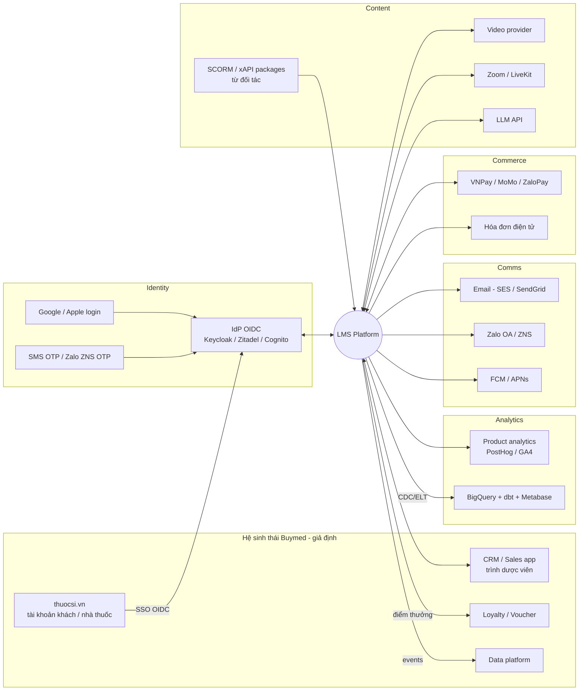

# 06. Tích hợp

> Phần liên quan Buymed/thuocsi.vn là **giả định** dựa trên thông tin công khai (Buymed vận hành sàn thuocsi.vn và đang có kênh đào tạo trên Doccen). Cần team Buymed xác nhận hệ thống thực tế: IdP, CRM, data platform, API khách hàng.

## 1. Bản đồ tích hợp

## 2. Chi tiết từng tích hợp

### 2.1 Identity & SSO
| Hạng mục | Đề xuất |
|---|---|
| IdP | Một IdP chuẩn OIDC (Keycloak hoặc Zitadel self-host, Cognito, Auth0). **Nếu Buymed đã có IdP dùng chung cho thuocsi thì LMS là một OIDC client của IdP đó.** |
| Phương thức | SĐT + OTP (phổ biến nhất với HCP và nhà thuốc VN), email + password/magic link, Google, SSO thuocsi |
| Liên kết tài khoản | Bảng `auth_identities(user_id, provider, subject)`. Một user có nhiều cách đăng nhập. Gộp tài khoản khi trùng SĐT đã xác minh |
| OTP | Zalo ZNS (rẻ, tỉ lệ đến cao) và fallback SMS brandname. Rate limit theo SĐT, IP và device. Chống SMS pumping |
| Session | Web: cookie httpOnly + SameSite + CSRF token. Mobile: refresh token xoay vòng |

### 2.2 Buymed / thuocsi.vn (cơ hội khác biệt so với Doccen)
| Use case | Cơ chế tích hợp |
|---|---|
| Nhà thuốc đăng nhập bằng tài khoản thuocsi | SSO OIDC. Claims gồm `customer_id`, `pharmacy_id`, `province` |
| Tự động gán vào org/kênh "Nhà thuốc Buymed" | Khi SSO lần đầu, gán `member` @ org Buymed |
| Trình dược viên giao khóa cho nhà thuốc mình phụ trách | API `POST /orgs/{id}/assignments` (danh sách `customer_id`) từ app sales/CRM. Webhook trả trạng thái hoàn thành |
| Ra mắt sản phẩm mới thì có khóa đào tạo | Event `product.launched` từ thuocsi, LMS gợi ý khóa hoặc tự giao |
| Thưởng khi hoàn thành (điểm, voucher) | Event `course.completed` → Loyalty service cộng điểm hoặc phát voucher. **Idempotent** theo `(user_id, course_id)` |
| Cá nhân hóa | Dữ liệu ngành hàng đã mua (đã consent) gợi ý khóa học liên quan |

> ⚖️ Gắn thưởng thương mại với đào tạo cho người hành nghề cần legal review (tránh bị coi là khuyến mại thuốc không đúng quy định).

### 2.3 Nội dung
- **Video provider:** upload trực tiếp từ admin, webhook `ready`/`errored`, ký playback token, lấy thời lượng và thumbnail. Interface `VideoProvider` để có thể thay nhà cung cấp.
- **SCORM 1.2/2004 & xAPI:** đối tác dược thường có sẵn gói e-learning SCORM. Phase 2 hỗ trợ import và chạy SCORM trong iframe sandbox (thư viện scorm-again), lưu CMI vào `lesson_progress`. Có thể lưu xAPI statements vào LRS nội bộ (bảng) hoặc LRS ngoài.
- **LTI 1.3:** chỉ khi trường đại học muốn nhúng khóa vào LMS của trường. Để sau.
- **Live:** Zoom API (tạo webinar, đăng ký người tham dự, lấy participant report) hoặc LiveKit (token theo user, webhook `participant_joined/left`).
- **LLM:** gọi qua một module `ai-gateway` nội bộ (quản lý prompt, giới hạn chi phí, log, lọc PII, đổi provider).

### 2.4 Thanh toán & hóa đơn
- VNPay / MoMo / ZaloPay: redirect hoặc QR. **Webhook IPN là nguồn sự thật**, không tin redirect. Xác thực chữ ký và idempotency key. Đối soát hằng ngày.
- Hóa đơn điện tử: tích hợp nhà cung cấp (MISA meInvoice, VNPT, Viettel…) qua API khi thanh toán thành công.
- B2B (nhà tài trợ trả tiền): hợp đồng ngoài hệ thống. LMS quản lý **voucher/seat** do tài trợ phát.

### 2.5 Thông báo
- Kênh: in-app, email, Zalo ZNS (template phải được duyệt), push (mobile), SMS (dự phòng).
- **Notification service** nhận event (ví dụ `webinar.reminder_24h`, `certificate.issued`, `kyc.approved`), áp dụng **preferences** của user và giờ yên lặng, dedupe, gửi qua provider, lưu trạng thái.

### 2.6 Dữ liệu & phân tích
- **Product analytics:** PostHog (self-host được) hoặc GA4. Định nghĩa **tracking plan** từ đầu (ví dụ `lesson_started`, `lesson_completed`, `quiz_submitted`, `search_performed`).
- **Warehouse:** CDC (Debezium hoặc Datastream) hoặc ELT (Airbyte) sang BigQuery, mô hình hóa bằng dbt, xem bằng Metabase/Looker Studio. Dashboard sponsor lấy từ warehouse (bảng tổng hợp đã k-anonymize).
- **Xuất cho cơ sở CME:** Excel/CSV theo mẫu của đơn vị, ký số nếu cần.

## 3. Nguyên tắc tích hợp
1. **Event-driven qua outbox:** module ghi `outbox_events` trong cùng transaction nghiệp vụ, relay đẩy lên queue. Consumer idempotent theo `event_id`.
2. **Anti-corruption layer:** mỗi provider ngoài có adapter riêng, domain không phụ thuộc SDK của bên thứ ba.
3. **Webhook vào:** verify chữ ký, lưu raw payload, xử lý bất đồng bộ, trả 2xx nhanh.
4. **Webhook ra (cho đối tác):** ký HMAC, retry với exponential backoff, có trang xem log gửi.
5. **API công khai cho đối tác (Phase 2+):** OAuth2 client credentials, scope theo org, rate limit, OpenAPI docs.
